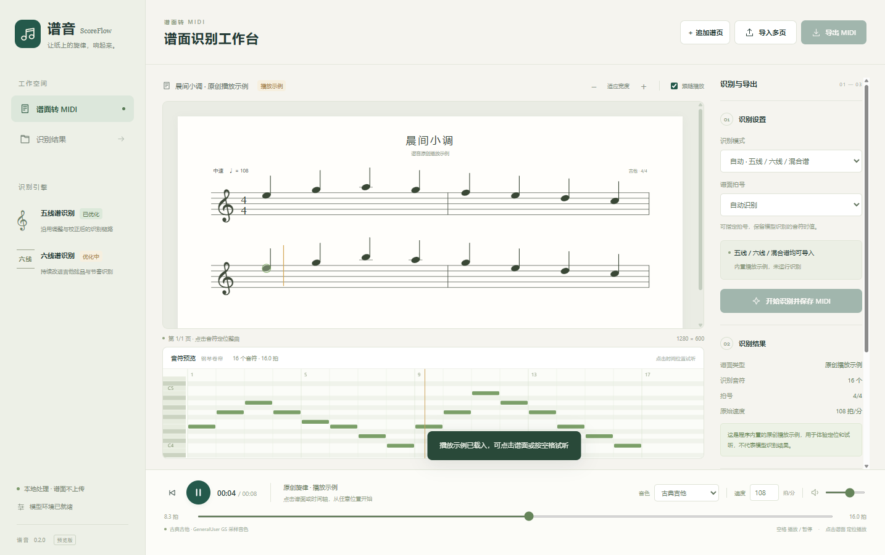

# 谱音 ScoreFlow

[安装指引](docs/INSTALL.zh-CN.md) · [GitHub 发布指引](docs/GITHUB_RELEASE.md) · [视频介绍方案](docs/VIDEO_PLAN.zh-CN.md)

**把多页吉他乐谱转成一首可播放、可保存的 MIDI。**

一次导入谱面图片，按页序识别并连接整首曲子；点击谱面音符即可从对应位置试听，播放时自动翻页。桌面界面使用 Electron，Python 仅运行后台识别，不承担 UI。

**0.2.0 预览版：五线谱识别链路已做专项调整和校正；六线谱已接入，仍在优化。**



*截图是程序自带的原创播放示例，用于说明界面与定位播放，不代表模型识别结果。应用界面与使用文档统一为简体中文。*

## 主要功能

- **三种版式**：五线谱、纯六线谱、五线谱与六线谱混合页。
- **连续多页**：每首曲目最多 64 张图片，支持自然数字排序、调整页序、追加和移除。
- **完整曲目**：逐页串行识别，按实际时长连接，保留页尾休止、分数拍和结构兼容时的跨页延音。
- **点谱面播放**：点击任意页音符、整曲卷帘或进度条定位；开启“跟随播放”时自动翻页。
- **MIDI 显示**：卷帘展示整曲音高、时值和页边界。
- **7 种采样音色**：古典吉他、钢弦吉他、清音电吉他、三角钢琴、电钢琴、弦乐合奏和长笛。试听调速保持音高。
- **自动保存与导出**：保存完整 MIDI，可另存带所选 GM 音色的 MIDI，以及结构兼容时的合并 MusicXML。
- **已完成页复用**：在当前打开曲目中，调整页序只重新合并；追加只识别新页；取消后可复用输入和设置未变化的已完成页。

## 下载后怎么运行

本仓库按**源码目录**发布。下载后会看到 `启动谱音.cmd`、`安装识别环境.cmd`、`app/`、`engine/` 和 `README.md`；源码本身不包含 EXE、大模型或数 GB 的推理依赖。

### 第一步：安装三个基础组件

| 组件 | 版本与下载地址 | 用途 |
| --- | --- | --- |
| Node.js | **22.12 或更新版本**，选择 [官方 LTS 安装包](https://nodejs.org/en/download)的 Windows x64 版 | 运行 Electron 桌面界面 |
| Python | **3.12，Windows x64**，可使用 [Python 3.12.10 安装包](https://www.python.org/downloads/release/python-31210/)；安装时保留 Python Launcher | 只运行后台识别和环境安装脚本 |
| NVIDIA 显卡驱动 | 按显卡型号安装 [NVIDIA 官方驱动](https://www.nvidia.com/en-us/drivers/) | 支持本地 GPU 推理 |

安装完成后重新打开终端或双击入口。识别需要 NVIDIA CUDA 显卡；已验证 RTX 3070 8 GB，开始识别前要求约 **5.5 GiB 空闲显存**。当前不支持 CPU、AMD 或 Intel GPU 识别。

### 第二步：双击“安装识别环境.cmd”

首次安装需要联网，会下载 **PyTorch 2.7.1（CUDA 12.8）**、**torchvision 0.22.1**、**ONNX Runtime GPU 1.24.4**、图像处理依赖、HOMR 五线谱权重、Tabbox 六线谱公开权重、FluidSynth 和采样音色。

这些文件默认安装到 **`%LOCALAPPDATA%\ScoreFlow\runtime`**，不放进源码目录。下载和安装需要数 GB 空间；请留出至少 12 GB 作为运行文件、下载缓存和临时文件空间。安装失败会停在错误信息处，修复网络或驱动后可重新运行。

**通常不需要额外安装完整 CUDA Toolkit。** 安装脚本从 PyTorch 官方 CUDA 12.8 软件源获取运行库；NVIDIA 显卡驱动仍需单独安装。`nvidia-smi` 显示的 CUDA 版本表示驱动支持能力，不表示模型已安装。[PyTorch 安装依据](https://pytorch.org/get-started/previous-versions/)、[ONNX Runtime CUDA 依赖说明](https://onnxruntime.ai/docs/execution-providers/CUDA-ExecutionProvider.html)

### 第三步：双击“启动谱音.cmd”

首次启动会执行 `npm ci` 下载 Electron 桌面依赖，之后直接打开软件。识别环境安装成功后会自动保存路径；也可以在软件左下角点击 **配置模型运行环境**，选择直接包含 `model_registry.json` 的文件夹。

进入软件后：**导入多页 → 检查页序 → 选择识别模式 → 开始识别并保存 MIDI → 点谱试听 → 导出 MIDI**。

如果要把运行环境装在 D 盘，在源码根目录打开 PowerShell：

```powershell
powershell.exe -NoProfile -ExecutionPolicy Bypass -File .\scripts\install-runtime.ps1 -RuntimeRoot 'D:\ScoreFlowRuntime'
```

完整步骤、目录结构、手动安装命令和故障处理见 [中文安装指引](docs/INSTALL.zh-CN.md)。

## 模型与依赖从哪里下载

| 资源 | 本版使用版本 / 来源 | 源码内是否包含 |
| --- | --- | --- |
| 五线谱 HOMR | 465 FP16，三份 [官方 ONNX 权重](https://github.com/liebharc/homr/releases/tag/onnx_checkpoints)，叠加本项目校正规则 | 不含权重；包含校正规则及约 3.4 KB 的谱号校准资源 |
| 六线谱 Tabbox | [kk9293/guitar-tab-omr](https://huggingface.co/kk9293/guitar-tab-omr) 的 `best.pt`，配套 [官方推理代码](https://github.com/LIU9293/guitar-tab-omr) | 不含权重和外部架构代码，安装时分别下载 |
| PyTorch / torchvision | 2.7.1 / 0.22.1，[官方 CUDA 12.8 软件源](https://download.pytorch.org/whl/cu128) | 不含安装后的依赖，只记录安装命令与版本 |
| ONNX Runtime GPU | 1.24.4，[官方安装说明](https://onnxruntime.ai/docs/install/) | 不含安装后的依赖 |
| FluidSynth / GeneralUser GS | [FluidSynth 2.6.0](https://github.com/FluidSynth/fluidsynth/releases/tag/v2.6.0)、[GeneralUser GS 2.0.3](https://github.com/mrbumpy409/GeneralUser-GS) | 不含合成器和音色文件，安装时下载 |

**公开安装默认使用 Tabbox 官方权重。** 原标注器部署的本地调整版也是 Tabbox，但与公开权重不同；安装脚本另有 `--tab-model` 和 `--tab-code` 参数，可配置该权重及配套脚本。不要把两份权重混称为同一版本，也不要修改校验值来绕过检查。五线谱的本项目校正链路在两种环境中都保留。

普通 Python 依赖版本见 [requirements-runtime.txt](requirements-runtime.txt)，固定下载 URL、代码版本和 SHA-256 见 [runtime-downloads.json](engine/runtime-downloads.json)。保留原环境的分目录版本记录见 [runtime-dependencies.json](engine/runtime-dependencies.json)；它是原环境快照，不是要求安装两个 ONNX Runtime 的命令清单。

安装时需要联网下载资源；环境齐全后的谱面识别、MIDI 生成和试听在本机完成，无需云端 API 密钥。

## 第一次使用

1. 点击 **导入多页**，一次选择 PNG、JPG/JPEG、WebP 或 BMP 图片。
2. 检查谱页顺序，用左右箭头调整，也可以追加或移除谱页。
3. 选择识别模式和拍号，点击 **开始识别并保存 MIDI**。
4. 等待全部页面完成并合成整曲；任一页失败时，不会把缺页结果当成完整曲目导出。
5. 查看卷帘、点击谱面试听；空格暂停或继续，底部切换音色、速度和音量。
6. 点击 **导出 MIDI** 另存，或点击 **识别结果** 查看自动保存文件。

自动保存通常位于 `%APPDATA%\ScoreFlow\results\piece-…\complete\`。源图不被改写。试听速度不改写识别事件；导出的 MIDI 保留识别结果的速度，并写入所选音色。

## 识别链路

| 输入 | 自动模式 | 手动选择 |
| --- | --- | --- |
| 五线谱 | HOMR 465 FP16 与现有校正链路 | 五线谱 |
| 纯六线谱 | Tabbox 公开权重或可选本地调整版，按谱行分段批量解码 | 六线谱 |
| 混合页 | 遮罩六线谱区域，保留原页坐标，优先走五线谱链路 | 选择“六线谱”读取混合页中的六线谱 |

五线谱增强包括八度谱号、重复音、反复记号及符合条件的节奏校正。“已优化”描述整条识别链路，不表示所有神经网络权重都经过微调，也不承诺未经统一测试的准确率。六线谱仍需试听核对，点击定位采用检测小节内的近似位置。

## 当前边界

- 不含 PDF 导入、音符编辑、训练界面或人工修正工具。
- 整曲统一采用第一页速度；未实现逐段速度变化的完整播放处理。
- 页间声部数量变化时仍可生成完整 MIDI，但停用合并 MusicXML，保留各页 MusicXML。
- 缺少可靠坐标时可用卷帘和进度条定位，不能保证逐音谱面落点。
- 当前曲目的识别缓存不是可重新打开的项目格式；退出前请导出需要的 MIDI，自动保存文件仍保留在磁盘。

## 开发与构建

需要 Node.js **22.12 或更新版本**。在源码根目录执行：

```powershell
npm ci
npm start
```

这是“启动谱音.cmd”对应的手动方式。后台识别环境通过“安装识别环境.cmd”单独安装，见 [中文安装指引](docs/INSTALL.zh-CN.md) 和 [运行环境约定](RUNTIME.md)。

```powershell
npm test
python tests/engine_test.py
python tests/assemble_test.py
python tests/setup_runtime_test.py
npm run build
```

两个 Python 单元测试只使用标准库，可用 Python 3.11 或 3.12；实际推理环境固定为 Python 3.12。构建命令生成桌面文件，不会自动带上模型，构建前应关闭正在运行的已打包软件。

`app/` 为 Electron 界面和播放，`engine/` 为识别、合并和导出，`scripts/` 为环境安装、启动和构建，`tests/` 为验证。现有标注器运行环境的提取方式见 [RUNTIME.md](RUNTIME.md)。

## 验证与反馈

0.2.0 已通过 10 项 JavaScript 单元测试、3 项 Python 导出测试、8 项跨页合并测试及 41 项打包后桌面检查。三页集成样例合成 94 个音符、88 拍，核对了 MIDI 起点与结束时间。**这是集成验证，不是任意扫描谱面的识别准确率基准。** [验证摘要](docs/validation-v0.2.0.json)

源码启动补充验证已通过安装入口、首次 `npm ci` 启动、21 项桌面检查，以及五线谱和 Tabbox 公开权重的真实识别与 MIDI 保存。测试范围与环境复用情况见 [源码安装验证记录](docs/validation-source-install.json)。

请在 Issues 中提供版本、显卡与驱动、模式、页数、复现步骤及相关日志；谱面样本应确认可以公开分享。

## 开源许可与致谢

源码使用 [AGPL-3.0-only](LICENSE)，保留 HOMR 派生代码的许可与来源。模型、CUDA、Python、FluidSynth、GeneralUser GS 和其他依赖遵循各自条款，不能由本项目许可证重新授权。详见 [THIRD_PARTY_NOTICES.md](THIRD_PARTY_NOTICES.md)。

感谢 HOMR、Guitar Tab OMR / Tabbox、FluidSynth、S. Christian Collins 的 GeneralUser GS 及其相关开源项目。
